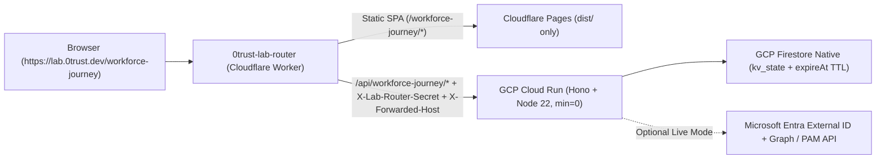

# Workforce Identity Lifecycle (`0trust-lab-workforce-journey`) — Local Architecture

> **Role in the 0trust.dev Ecosystem**: Standalone **Model 1** micro-lab powering **Lab 1 (`/workforce-journey`)** at [`https://lab.0trust.dev/workforce-journey`](https://lab.0trust.dev/workforce-journey) via `0trust-lab-router` (local dev: `http://localhost:5174` with Vite `/api` proxy → local Hono server on `:8080`).
> **Global Architecture Reference**: [`c2pig/0trust.dev/docs/ARCHITECTURE.md`](https://github.com/c2pig/0trust.dev/blob/main/docs/ARCHITECTURE.md)

## Architecture Diagrams

- **Top-Down Value-Stream Blueprint**: [workforce_journey_blueprint_topdown.svg](./diagrams/workforce_journey_blueprint_topdown.svg)
- **Platform Capability Zoom-In**: [workforce_journey_platform_capability_zoomin.svg](./diagrams/workforce_journey_platform_capability_zoomin.svg)

## Request Split & Runtime Topology

## Components & Boundaries

### 1. Standalone Frontend (`src/`)
- **Entry & Shell**: [`src/main.tsx`](../src/main.tsx) → [`src/App.tsx`](../src/App.tsx) mounts [`WorkforceLabPage`](../src/pages/WorkforceLabPage.tsx) with an `onBackHome` link returning to `0trust.dev` (`http://localhost:5173/` in local dev, `https://0trust.dev/` in production) and an interactive [`driver.js`](https://driverjs.com/) orientation tour overlay (`Lab Tour`).
- **Dropdown Role Switcher** ([`RoleSwitcherBar`](../src/components/RoleSwitcherBar.tsx)): Compact AppShell dropdown with notification indicators switching between isolated role workspaces:
  1. **Maya Lin** (`Finance Controller`) — FinCore Treasury ERP (settlement batch table, HTTP 403 Standing Privilege modal, 15m JIT request modal)
  2. **Marcus Chen** (`Finance Manager`) — AccessGuard PAM (business-friendly Approval Desk & active approvals)
  3. **Priya Nair** (`Security Ops`) — JIT & Session Activity Monitor (live JIT/session activity table & CAEP Universal Logout trigger)
- **X-Ray Telemetry Drawer** ([`XRayTelemetryDrawer`](../src/components/XRayTelemetryDrawer.tsx)): Sticky-bottom drawer displaying live W3C `traceparent` spans, decoded JWT headers/claims, and SCIM 2.0 record state.
- **Client Engine** ([`workforceJourneyClient.ts`](../src/engine/workforceJourneyClient.ts)): Calls same-origin `/api/workforce-journey/*` (routed to GCP Cloud Run in production and proxied to local Hono `:8080` in `npm run dev`).

### 2. Cloud Run Backend Adapter (`server/`) & Handlers (`functions/api/`)
- **HTTP Server (`server/app.ts`, `server/index.ts`)**: Hono + `@hono/node-server` container (`Dockerfile`, multi-stage `node:22-alpine`, non-root `USER node`, port `8080`) wrapping the portable Web `Request`/`Response` and WebCrypto (`crypto.subtle`) handlers under `functions/api/`.
  - `GET /healthz`: Returns `200 { ok: true, lab: "workforce-journey" }` (exempt from router secret for Cloud Run startup/liveness probes; touches no secrets or Firestore).
  - **Fail-Closed Origin Auth**: Constant-time `crypto.timingSafeEqual` verification of `X-Lab-Router-Secret` on all `/api/*` routes; returns `403 FORBIDDEN_DIRECT_ORIGIN` if missing/invalid or if `LAB_ROUTER_SECRET` is unset in `ENVIRONMENT=production`.
- **Public Origin Reconstruction (`server/origin.ts`)**: Reconstructs `https://lab.0trust.dev` (or local `localhost:*`) from allowlisted `X-Forwarded-Host` and `X-Forwarded-Proto` headers for `entra/login.ts` and `entra/callback.ts` OAuth `redirect_uri` and post-auth redirects; rejects forged hosts and falls back to `new URL(req.url).origin`.
- **Firestore KV Adapter (`server/kvAdapter.ts`)**: Implements `STATE_KV` (`get`, `put` with `expirationTtl`, `delete`) over GCP Firestore Native collection `kv_state` with document IDs `${labSlug}:${encodeURIComponent(key)}` and **synchronous TTL enforcement on read** (`expireAt <= Date.now()` returns `null`). Automatically falls back to `MemoryKvAdapter` during local `npm run dev` when no GCP/Firestore credentials are present.
- **Observability Middleware** ([`_middleware.ts`](../functions/api/_middleware.ts)): Propagates W3C `traceparent`, injects `_telemetry` and `X-Edge-Latency-Ms`, redacts JWT signatures in `Authorization`, never logs/exports `X-Lab-Router-Secret` or `OTLP_AUTH_HEADER`, and exports optional OTLP spans via non-blocking `waitUntil`.
- **API Endpoints** (`functions/api/workforce-journey/`):
  - `GET /api/workforce-journey/config`
  - `POST /api/workforce-journey/login-provision`
  - `POST /api/workforce-journey/jit-submit`
  - `POST /api/workforce-journey/jit-decision`
  - `POST /api/workforce-journey/request-jit`
  - `POST /api/workforce-journey/protected-call`
  - `POST /api/workforce-journey/logout`
  - `GET /api/workforce-journey/entra/login`
  - `GET /api/workforce-journey/entra/callback`

### 3. Firestore Native State (`kv_state`)
- Document ID format: `workforce-journey:${encodeURIComponent(key)}` with fields `{ value, expireAt, updatedAt, labSlug }`.
- Key prefixes:
  - `lab1:dir:<sessionId>` — SCIM 2.0 directory record & active `jti` list (`3600s` TTL)
  - `lab1:jit-req:<sessionId>:<requestId>` — Pending/decided JIT elevation requests (`3600s` TTL)
  - `lab1:revoked:<sessionId>:<jti>` — CAEP Universal Logout revocation tombstones (`3600s` TTL)
  - `lab1:pkce:<state>` — Entra OIDC PKCE state (`600s` TTL)
  - `lab1:entra-oidc:<ticket>` — Verified Entra OIDC session ticket (`3600s` TTL)

### 4. Infrastructure & CI/CD (`infra/terraform/`, `.github/workflows/deploy.yml`)
- **Cloudflare Pages (Static SPA)**: `managed-infrastructure//modules/cloudflare-pages-lab` (`enable_custom_domain = false`). `deploy.yml` `deploy-pages` job strips `functions/` and deploys `dist/` only.
- **GCP Cloud Run API**: `managed-infrastructure//modules/cloud-run-lab` (`min_instance_count = 0`, `$0` idle cost, dedicated least-privilege runtime SA with per-secret `roles/secretmanager.secretAccessor` and `roles/datastore.user`). `deploy.yml` `deploy-cloudrun` job authenticates via GitHub Actions WIF OIDC, builds/pushes to Artifact Registry (`0trust-labs/workforce-journey:${GITHUB_SHA}`), and deploys to Cloud Run.
- **Microsoft Entra External ID (Optional)**: `managed-infrastructure//modules/entra-external-ciam` provisions the CIAM app registration and 15-minute JIT privileged security group.

### 5. Automated Hub Sync & Shell Parity
- **Hub Dispatch (`.github/workflows/sync-to-hub.yml`)**: Fires a `repository_dispatch` (`event_type: lab_contract_updated`) to `c2pig/0trust.dev` whenever `lab.manifest.json` or `docs/diagrams/*.svg` changes on `main`.
- **Shared Shell (`@0trust/lab-shell`)**: `RoleSwitcherBar.tsx`, `XRayTelemetryDrawer.tsx`, `src/shell/index.ts`, and `src/index.css` are kept in parity with `c2pig/0trust.dev` via `scripts/sync-lab-shell.mjs`.
