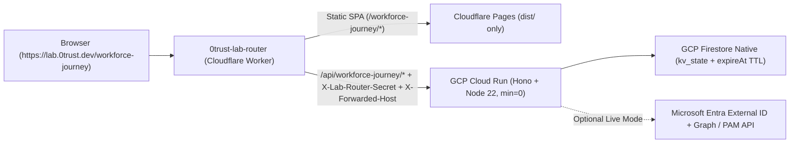

# Workforce Identity Lifecycle (`0trust-lab-workforce-journey`) — Local Architecture

> **Role in the 0trust.dev Ecosystem**: Standalone **Model 1** micro-lab powering **Lab 1 (`/workforce-journey`)** at [`https://lab.0trust.dev/workforce-journey`](https://lab.0trust.dev/workforce-journey) via `0trust-lab-router` (local dev: `http://localhost:5174` with Vite `/api` proxy → local Hono server on `:8080`).
> **Global Architecture Reference**: [`c2pig/0trust.dev/docs/ARCHITECTURE.md`](https://github.com/c2pig/0trust.dev/blob/main/docs/ARCHITECTURE.md)

## Architecture Diagrams

- **Top-Down Value-Stream Blueprint**: [workforce_journey_blueprint_topdown.svg](./diagrams/workforce_journey_blueprint_topdown.svg)
- **Platform Capability Zoom-In**: [workforce_journey_platform_capability_zoomin.svg](./diagrams/workforce_journey_platform_capability_zoomin.svg)

## Request Split & Runtime Topology

## Components & Boundaries

### 1. Standalone Frontend (`src/`)
- **Entry & Shell**: [`src/main.tsx`](../src/main.tsx) → [`src/App.tsx`](../src/App.tsx) mounts [`WorkforceLabPage`](../src/pages/WorkforceLabPage.tsx) (thin ~235-line orchestrator backed by [`useWorkforceLab`](../src/hooks/useWorkforceLab.ts)) with an `onBackHome` link returning to `0trust.dev` (`http://localhost:5173/` in local dev, `https://0trust.dev/` in production) and an interactive [`driver.js`](https://driverjs.com/) orientation tour overlay (`Lab Tour`).
- **Dropdown Role Switcher** ([`RoleSwitcherBar`](../src/components/RoleSwitcherBar.tsx) with `variant="dropdown"`): Compact AppShell dropdown with per-seat `avatarColor` and notification indicators switching between modularized role workspace components under `src/components/workforce/`:
  1. **Maya Lin** (`Finance Controller`) — [`FinCoreErpSeat.tsx`](../src/components/workforce/FinCoreErpSeat.tsx) (FinCore Treasury ERP settlement batch table, HTTP 403 Standing Privilege modal, 15m JIT request modal)
  2. **Marcus Chen** (`Finance Manager`) — [`AccessGuardPamSeat.tsx`](../src/components/workforce/AccessGuardPamSeat.tsx) (AccessGuard PAM Approval Desk & active approvals)
  3. **Priya Nair** (`Security Ops`) — [`IdentityThreatMonitorSeat.tsx`](../src/components/workforce/IdentityThreatMonitorSeat.tsx) (JIT & Session Activity Monitor table & CAEP Universal Logout trigger)
- **X-Ray Telemetry Drawer** ([`XRayTelemetryDrawer`](../src/components/XRayTelemetryDrawer.tsx)): Sticky-bottom drawer displaying live W3C `traceparent` spans, decoded JWT headers/claims, and SCIM 2.0 record state.
- **Client Engine** ([`workforceJourneyClient.ts`](../src/engine/workforceJourneyClient.ts)): Calls same-origin `/api/workforce-journey/*` (routed to GCP Cloud Run in production and proxied to local Hono `:8080` in `npm run dev`).

### 2. Cloud Run Backend Adapter (`server/`) & Handlers (`functions/api/`)
- **Shared Runtime (`server/runtime.ts`, `server/app.ts`, `server/index.ts`)**: `server/runtime.ts`, `server/kvAdapter.ts`, `server/origin.ts`, `server/index.ts`, and the canonical multi-stage `Dockerfile` (`node:22-alpine`, `COPY src ./src` in builder, non-root `USER node`, port `8080`) are synced from `c2pig/0trust.dev/templates/lab-runtime/`. `server/app.ts` is a thin wrapper calling `createBaseLabApp` (re-exporting `verifyRouterSecret`), binding lab-specific `extraEnv` (`LAB1_JWT_SECRET`, `ENTRA_EXT_*`, `PRIVILEGED_GROUP_ID`, `PAM_API_*`), and registering the `/api/workforce-journey/*` routes.
  - `GET /healthz`: Returns `200 { ok: true, lab: "workforce-journey" }` (exempt from router secret for Cloud Run startup/liveness probes; touches no secrets or Firestore).
  - **Fail-Closed Origin Auth**: Constant-time `crypto.timingSafeEqual` verification of `X-Lab-Router-Secret` on all `/api/*` routes; returns `403 FORBIDDEN_DIRECT_ORIGIN` if missing/invalid or if `LAB_ROUTER_SECRET` is unset in `ENVIRONMENT=production`.
- **Public Origin Reconstruction (`server/origin.ts`)**: Reconstructs `https://lab.0trust.dev` (or local `localhost:*`) from allowlisted `X-Forwarded-Host` and `X-Forwarded-Proto` headers for `entra/login.ts` and `entra/callback.ts` OAuth `redirect_uri` and post-auth redirects; rejects forged hosts and falls back to `new URL(req.url).origin`.
- **Firestore KV Adapter (`server/kvAdapter.ts`)**: Implements `STATE_KV` (`get`, `put` with `expirationTtl`, `delete`) over GCP Firestore Native collection `kv_state` with document IDs `${labSlug}:${encodeURIComponent(key)}` and **synchronous TTL enforcement on read** (`expireAt <= Date.now()` returns `null`). Automatically falls back to `MemoryKvAdapter` during local `npm run dev` when no GCP/Firestore credentials are present.
- **Observability Middleware** ([`_middleware.ts`](../functions/api/_middleware.ts) + [`_telemetry.ts`](../functions/api/_telemetry.ts)): Shared OTLP/trace helpers propagate W3C `traceparent`, inject `_telemetry` and `X-Edge-Latency-Ms`, redact JWT signatures in `Authorization`, never log/export `X-Lab-Router-Secret` or `OTLP_AUTH_HEADER`, and export optional OTLP spans via non-blocking `waitUntil`.
- **API Endpoints** (`functions/api/workforce-journey/`):
  - `GET /api/workforce-journey/config`
  - `POST /api/workforce-journey/login-provision`
  - `POST /api/workforce-journey/jit-submit`
  - `POST /api/workforce-journey/jit-decision`
  - `POST /api/workforce-journey/request-jit`
  - `POST /api/workforce-journey/protected-call`
  - `POST /api/workforce-journey/logout`
  - `GET /api/workforce-journey/entra/login`
  - `GET /api/workforce-journey/entra/callback` (validates PKCE `state` in `STATE_KV`, verifies `id_token` claims `iss`/`aud`/`exp`/`nonce`, stores `lab1:entra-oidc:<ticket>`, and sets `HttpOnly; SameSite=Lax` cookie `lab1_entra_ticket` before redirecting to `/workforce-journey?entra_auth=1` with no PII/tickets in the URL)
  - `GET /api/workforce-journey/entra/session` (resolves authenticated Entra External ID identity from `lab1_entra_ticket` `HttpOnly` cookie)
- **API Security Controls**:
  - `workforceJourneyCrypto.ts` fails closed in `ENVIRONMENT=production` if `LAB1_JWT_SECRET` is missing or `< 16` chars, and enforces `header.alg === 'HS256'` plus `payload.exp` expiration.
  - `jit-decision.ts` requires a signed `Authorization: Bearer <approver_jwt>` with `Audit Approver` role and enforces self-approval prevention via verified `claims.email`.
  - `logout.ts` requires a valid signed `Authorization: Bearer <jwt>` matching `sessionId`, verifies any body tokens, and clears `lab1_entra_ticket`.
  - All 6 POST routes enforce a 64 KB JSON request body size cap (`413 PAYLOAD_TOO_LARGE`).

### 3. Firestore Native State (`kv_state`)
- Document ID format: `workforce-journey:${encodeURIComponent(key)}` with fields `{ value, expireAt, updatedAt, labSlug }`.
- Key prefixes:
  - `lab1:dir:<sessionId>` — SCIM 2.0 directory record & active `jti` list (`3600s` TTL)
  - `lab1:jit-req:<sessionId>:<requestId>` — Pending/decided JIT elevation requests (`3600s` TTL)
  - `lab1:revoked:<sessionId>:<jti>` — CAEP Universal Logout revocation tombstones (`3600s` TTL)
  - `lab1:pkce:<state>` — Entra OIDC PKCE state (`600s` TTL)
  - `lab1:entra-oidc:<ticket>` — Verified Entra OIDC session ticket (`3600s` TTL)

### 4. Infrastructure & CI/CD (`infra/terraform/`, `.github/workflows/ci.yml`, `.github/workflows/deploy.yml`)
- **PR CI (`.github/workflows/ci.yml`)**: Runs `npx tsc --noEmit`, `npx tsc -p tsconfig.server.json --noEmit`, `npm test`, and `npm run build` (`test-and-build`), plus a `terraform-validate` job (`terraform fmt -check`, `terraform init -backend=false -input=false`, `terraform validate` with Terraform `1.11.4` and multi-platform `.terraform.lock.hcl`) on every `pull_request` to `main`.
- **Serialized Deploy Pipeline (`.github/workflows/deploy.yml`)**: Runs `test` first, then `deploy-cloudrun` (`needs: test`), then `deploy-pages` (`needs: [test, deploy-cloudrun]`) so API revisions roll out before static SPAs.
- **Immutable Module Pinning & Remote Terraform State (`infra/terraform/main.tf`, `infra/terraform/backend.tf`)**: All `c2pig/managed-infrastructure` module references are pinned to immutable release tag `?ref=v1.0.0` (never floating `?ref=main`). Remote state is stored in GCS via `backend "gcs"` (`bucket = "0trust-dev-tfstate"`, `prefix = "labs/workforce-journey"`). Local `*.tfstate*` and `.terraform/` are gitignored; after one-time bucket provisioning (Uniform Bucket-Level Access, versioning enabled, `public_access_prevention = "enforced"`), operators migrate local state via `terraform init -migrate-state`.
- **Cloudflare Pages (Static SPA)**: `managed-infrastructure//modules/cloudflare-pages-lab?ref=v1.0.0` (`enable_custom_domain = false`). `deploy.yml` `deploy-pages` job strips `functions/` and deploys `dist/` only.
- **GCP Cloud Run API**: `managed-infrastructure//modules/cloud-run-lab?ref=v1.0.0` (`min_instance_count = 0`, `$0` idle cost, dedicated least-privilege runtime SA with per-secret `roles/secretmanager.secretAccessor` and `roles/datastore.user`). `deploy.yml` `deploy-cloudrun` job authenticates via GitHub Actions WIF OIDC, builds/pushes to Artifact Registry (`zerotrust-labs/workforce-journey:${GITHUB_SHA}`), and deploys to Cloud Run.
- **Microsoft Entra External ID (Optional)**: `managed-infrastructure//modules/entra-external-ciam?ref=v1.0.0` provisions the CIAM app registration and 15-minute JIT privileged security group.

### 5. Automated Hub Sync & Shell Parity
- **Hub Dispatch (`.github/workflows/sync-to-hub.yml`)**: Fires a `repository_dispatch` (`event_type: lab_contract_updated`) to `c2pig/0trust.dev` whenever `lab.manifest.json` or `docs/diagrams/*.svg` changes on `main`.
- **Shared Shell & Runtime (`@0trust/lab-shell`)**: `RoleSwitcherBar.tsx`, `XRayTelemetryDrawer.tsx`, `src/shell/index.ts`, `src/index.css`, `functions/api/{_middleware,_telemetry}.ts`, `server/{kvAdapter,origin,runtime,index}.ts`, and `Dockerfile` are kept in parity with `c2pig/0trust.dev` via `scripts/sync-lab-shell.mjs`.

### 6. End-to-End Grafana Cloud Observability (OTLP `/v1/traces` + `/v1/logs`)
- **Middleware (`functions/api/_middleware.ts`) & Cloud Run (`server/app.ts`)**: Exports non-blocking OTLP/HTTP `/v1/traces` and `/v1/logs` spans via `waitUntil` with `OTEL_SERVICE_NAME=zerotrust-lab-workforce-journey` (resolved via `resolveServiceName(env)`), W3C `traceparent` 2-hop correlation (`0trust-lab-router` → `zerotrust-lab-workforce-journey`), pathname-only `http.target`, and strict JWT signature redaction (`0trust.redaction_applied`).
- **Secret Hygiene**: `OTLP_AUTH_HEADER` is mounted from GCP Secret Manager secret `grafana-otlp-auth-header` (per-secret `roles/secretmanager.secretAccessor` on `sa-lab-workforce-journey`) and is never logged or returned in responses.
- **X-Ray Drawer (`src/components/XRayTelemetryDrawer.tsx`)**: Includes the `"Global Live Dashboard ↗"` link to `https://0trust.dev/observability` alongside live `traceparent` and redaction proofs.

---

## Turnstile & 3-Minute Single-Session Lease Gate
- **Frontend Guard (`src/components/LabLeaseGuard.tsx`, re-exported via `src/shell/index.ts`)**: `src/App.tsx` wraps `<WorkforceLabPage>` with `<LabLeaseGuard labSlug="workforce-journey" labTitle="Workforce Identity Lifecycle">`.
- **Edge Enforcement (`0trust-lab-router` + `LabLeaseDO`)**: Queries `GET /api/lease/workforce-journey/status`, renders the explicit Cloudflare Turnstile widget (`0x4AAAAAAGVF1oWC5CsFWn-J`) when available, acquires an `HttpOnly; Secure; SameSite=Lax` lease cookie (`lab_lease_workforce-journey`) via `POST /api/lease/workforce-journey/acquire` (180s hard cap, 25 calls/lease, 200 calls/UTC day), shows a countdown lock screen when occupied, and exposes a floating `MM:SS + End Lab` pill while active.
- **Zero Engine Changes**: All existing same-origin `/api/workforce-journey/*` requests carry the `HttpOnly` lease cookie automatically; local development (`localhost` / `127.0.0.1`) and disabled lease configs pass through transparently.

- **X-Ray Telemetry Drawer Theme**: Uses Chrome DevTools Light Mode palette (`#ffffff` / `#f1f3f4` surfaces, `#dadce0` borders, `#202124` / `#5f6368` text, `#1a73e8` active indicators) for high-contrast readability.
